# s3-policy-audit

s3-policy-audit reads exported S3 bucket policies (the JSON from `aws s3api get-bucket-policy`) and bucket configuration exports (public access block, ACL, encryption, versioning, logging). It reports public principals with no condition, wildcard actions and resources, `NotPrincipal` and `NotAction` allows, a missing TLS-only deny, an incomplete public access block, ACL grants to everyone, and missing default encryption, versioning or access logging.



**Live demo:** https://jvch0512.github.io/s3-policy-audit/ (Synthetic data.)

Rust 1.70+, serde_json only. The demo page is rendered from the tool's `--tsv` output by `scripts/site.py` (Python 3, only needed to regenerate the page).

## Use

```bash
make build
target/release/s3-policy-audit examples
target/release/s3-policy-audit ./exports --tsv
target/release/s3-policy-audit ./exports --fail-on high       # exit 1 on any high finding
```

A policy document has a `Statement` key. A configuration export has a `Bucket` or `PublicAccessBlock` key and may carry `PublicAccessBlock`, `Acl` (with `Grants`), `Encryption`, `Versioning` (string) and `Logging`. See [examples](examples).

Exit codes: 0 ok, 1 findings at or above `--fail-on`, 2 bad input. Output is human text by default and TSV with `--tsv` (`# N files, M findings`, then `SEVERITY<TAB>RULE<TAB>WHERE<TAB>MESSAGE`).

| Rule | Severity | What it catches |
|---|---|---|
| S3001 | critical, high or medium | an Allow for a public principal (`*`): critical when it can write or delete, high when it can read, medium when a `Condition` exists and must be checked |
| S3002 | medium | a non-public principal with `Action` set to `*` or `s3:*` |
| S3003 | medium | `Resource` is `*` instead of the bucket and its objects |
| S3004 | medium | no statement denies requests with `aws:SecureTransport` false |
| S3005 | high | the public access block is missing or one of its four settings is not true |
| S3006 | medium | no default encryption |
| S3007 | low | versioning is not `Enabled` |
| S3008 | low | access logging is off |
| S3009 | high or critical | an ACL grants access to `AllUsers` or `AuthenticatedUsers` (critical for WRITE or FULL_CONTROL to `AllUsers`) |
| S3010 | medium | an Allow that uses `NotPrincipal` or `NotAction` |
| S3000 | info | the file is not valid JSON or is neither a policy nor a bucket configuration |

See [examples](examples) and [docs/sample-output.txt](docs/sample-output.txt).

## Limits

- It reads exported JSON. It does not call AWS, so account-level settings (S3 Block Public Access at account level, SCPs, access points) are not seen.
- Conditions are not evaluated. A public principal with a `Condition` is reported at medium for a human to read.
- IAM policies attached to roles and users are out of scope.
- Object ACLs are not part of a bucket export.

## Where it fits

Reviewing S3 exports during a cloud security assessment, and as a CI gate on Terraform plans exported to JSON.

## Tests

```bash
make test    # Rust unit tests and CLI integration tests: every rule on good and bad policies, string and array forms, hostile JSON, fuzzing and exit codes
```

MIT.

## Code scanning (SARIF)

`scripts/tsv2sarif.py` converts the `--tsv` output into SARIF 2.1.0, so findings show up in GitHub code scanning:

```sh
target/release/s3-policy-audit examples --tsv | python3 scripts/tsv2sarif.py --tool s3-policy-audit --prefix examples > results.sarif
```

Upload `results.sarif` with `github/codeql-action/upload-sarif`. Severities map to SARIF levels (critical and high to error, medium to warning, low and info to note) and to a `security-severity` score.
